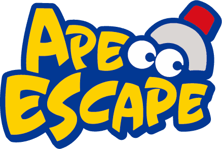

  

<h1 align="center">Ape Escape Recompiled — Enhanced Edition</h1>

  A fan-made, native PC project for revisiting Spike's first monkey-catching adventure.
   
  <a href="https://github.com/NVDEMU/ApeEscapeRecomp-MacWindows/releases">Get builds</a>
  ·
  <a href="https://github.com/NVDEMU/ApeEscapeRecomp-MacWindows/actions">Build status</a>
  ·
  <a href="ISSUES.md">Known issues and research notes</a>

---

## Welcome to the Monkey Lab

This repository packages the North American **Ape Escape** game (SCUS-94423) as a native application through static recompilation. The goal is a convenient desktop experience with a dedicated launcher, flexible controller and video settings, saves, and an optional mod collection.

The project is still a work in progress. Getting to gameplay is not the same as verifying every stage, cutscene, boss, save path, or ending, so a complete end-to-end playthrough is **not yet certified**.

**The original game is not included.** You need your own legally obtained disc image. No retail PlayStation BIOS is bundled; OpenBIOS is supplied as the default alternative.

## Choose your platform

Nightly packages are produced by GitHub Actions when the build succeeds. Visit [Releases](https://github.com/NVDEMU/ApeEscapeRecomp-MacWindows/releases) for the assets currently available.

| Platform | Package to look for | Notes |
| --- | --- | --- |
| Windows, 64-bit | ZIP | Extract the package, then open the launcher executable. |
| macOS, Apple Silicon | ZIP or DMG | For M-series Macs. |
| macOS, Intel | ZIP or DMG | For Intel-based Macs. |

### First boot

1. Start the application and choose your own Ape Escape disc image in the launcher. A CUE sheet with its matching BIN track is recommended. CHD is also accepted.
2. Select a retail SCPH-1001 BIOS only if you have one and wish to use it; otherwise leave the bundled OpenBIOS selection in place.
3. Configure your controller and display to taste. The settings pages are still available even when you leave every optional mod disabled.
4. Open **Mods** only when you want to experiment with enhancements, enable the specific features you want, and then start the game.

On macOS, the app is ad-hoc signed rather than notarized, so Gatekeeper may ask you to approve opening it. The game image and any retail BIOS must remain in your own storage.

A DualShock-compatible controller is the natural fit: move Spike with the left stick and aim the net with the right stick. Keyboard bindings are available too, and controller bindings can be changed from the launcher.

## Make it your own

The launcher keeps the usual configuration controls alongside this project's optional features. Video, audio, system, hotkey, controller, save and mod pages remain available; the custom branding does not hide the original launcher options.

### Optional mods

Every mod feature starts **off**. Enabling one item does not turn on the others. The bundled catalog currently includes:

- **Widescreen** — select 16:9, 21:9 or adaptive presentation.
- **Interpolated Rendering** — optional intermediate-frame presentation rates. It requires OpenGL; it does not intentionally change the game's simulation cadence.
- **PGXP Precision** — optional geometry precision and texture handling.
- **Skip FMVs** — skip full-motion videos through the game's normal completion path.
- **Quick Gadget Select** — a compact gadget-selection row.
- **Gameplay Assist Pack** — separate Infinite Lives, Infinite Health, Infinite Air and Unlock All Gadgets switches.
- **Extended Draw Distance** — an experimental rendering tweak aimed at reducing certain distance pop-in paths.
- **Quality-of-Life Tools** — Quick Retry, camera sensitivity, collectible counters, a monkey-progress panel and a level timer.
- **Challenge Pack** — optional timed monkey hunts (3/5/10 minutes), no-damage runs, limited starting lives (1/3/5), and randomized challenges with an in-game status HUD. Every challenge starts disabled.
  - **Nightmare Mode** — one-hit health, a three-life maximum (including extra lives), and a three-minute limit per stage in one opt-in hardcore ruleset.

Treat the newer Quality-of-Life tools and Extended Draw Distance as experimental until you have tried them in the actual game. Quick Retry is a fast-respawn shortcut, **not** a full stage reload; the monkey-progress panel tracks caught/uncaught entries rather than showing live monkey positions. If an enhancement causes glitches or looks unlike the original, turn it back off.

The base game also retains its original rendering limits and culling behaviour. Widescreen or increased draw distance can expose pop-in that is not present in the standard view. For current limitations and reverse-engineering notes, see [ISSUES.md](ISSUES.md).

### Display, input and saves

The launcher offers resolution and window-size controls, fullscreen, rendering selection, supersampling, antialiasing, texture filtering, FMV filtering, audio options, hotkeys and input remapping. The precise controls shown can depend on the current runtime build.

Memory-card saves, save states and rewind are part of the project experience. Keep backups of important save data while using experimental builds or mods. Settings and saves are kept outside the macOS app bundle; avoid deleting the user data folder when replacing an app.

## Updates without hunting for downloads

Use **Check for Nightly Updates** in the launcher to check this repository's \`macos-nightly\` release. The helper chooses the matching platform package, checks its SHA-256 checksum and waits for the game application to close before installation. The Windows updater is designed to preserve saves, settings and other user-added files; macOS user data remains separate from the app bundle.

Older builds made before the updater was added cannot run an in-app update. Install one recent package from [Releases](https://github.com/NVDEMU/ApeEscapeRecomp-MacWindows/releases) first. If a suitable asset or a valid checksum is unavailable, use the release page instead of forcing an install.

## How the project is built

The Windows x64, Apple Silicon and Intel Mac packages are built in GitHub Actions. Successful pushes run the packaging and validation jobs; release assets include platform packages, SHA-256 sidecars and updater metadata.

The original-disc image used by CI is stored outside the public repository. The workflow retrieves it from configured private Dropbox credentials or the optional \`APE_ESCAPE_DISC_URL\` secret, then converts and verifies it in temporary build storage. The disc image, retail BIOS, and generated game translation are not committed as public source assets.

### Useful places in the source tree

| Path | Purpose |
| --- | --- |
| \`mods/preloaded/\` | Definitions and descriptions for launcher mod options. |
| \`src/mods/\` | Native callbacks for the built-in enhancement features. |
| \`recomp/launcher/ape_escape_logo.png\` | Transparent project logo used in this README and staged into the launcher during builds. |
| \`tools/apply_recomp_ui_update_patch.py\` | Project-specific branding/theme and updater integration for the pinned shared launcher. |
| \`tools/package_macos.sh\`, \`tools/package_release.ps1\` | Platform packaging scripts. |
| \`aot/overlays.json\`, \`docs/AOT_OVERLAYS.md\` | Ahead-of-time overlay inventory and implementation notes. |
| \`ISSUES.md\` | Known limitations and next reverse-engineering targets. |

## Credits, ownership and legal notes

This is an unofficial community project maintained by **nvd123 / NVDEMU**. It uses the [PSXRecomp framework](https://github.com/mstan/psxrecomp) and other open-source components; their existing licenses and attribution notices continue to apply. Contributor credits specific to individual mods remain in their manifests.

Ape Escape, its characters, original game code, music, graphics and related intellectual property belong to their respective rights holders, including Sony. This project is not endorsed by or affiliated with Sony Interactive Entertainment. You are responsible for sourcing and using game data and BIOS files lawfully. Do not upload copyrighted game images or retail BIOS files to public issues or pull requests.
